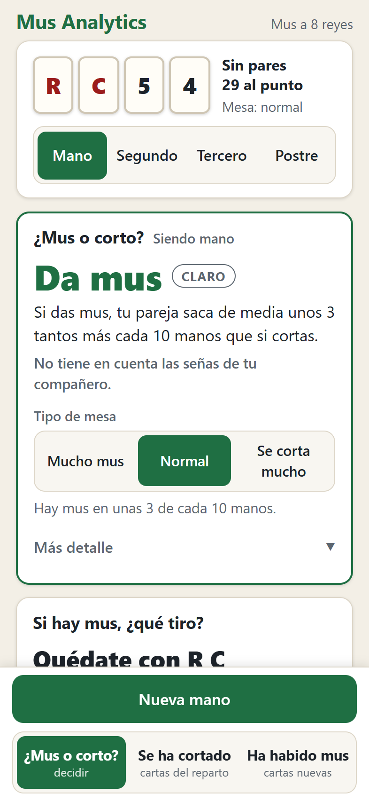
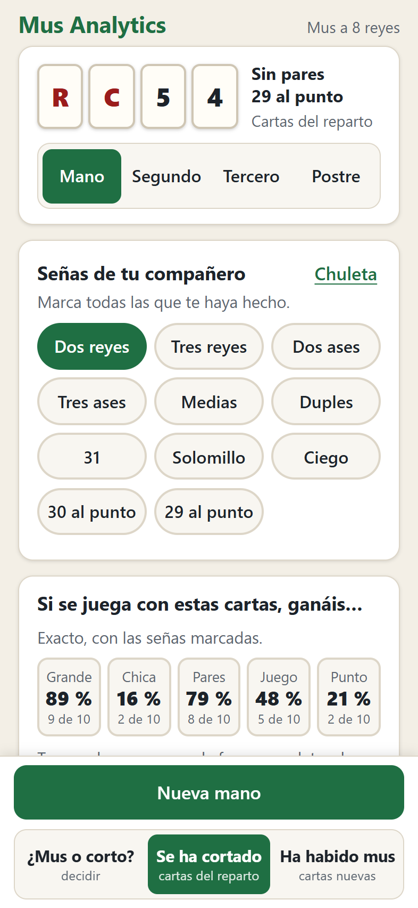
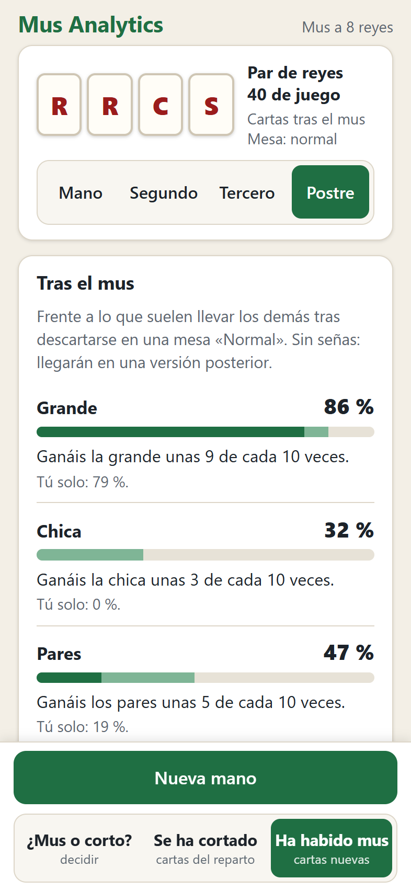

# Mus Analytics

Motor de estadísticas y estrategia para el **mus**, en su variante más extendida, a 8 reyes (también admite 4 reyes). Calcula con cuánta probabilidad gana cada mano cada lance, cómo conviene descartarse y cuándo merece la pena cortar el mus.

La idea es parecida a la de las calculadoras de póker (Equilab, GTO Wizard), pero para el mus y pensada para jugadores reales. Este repositorio contiene el **motor** en Python y la **web para el móvil** que consulta sus resultados.

**Pruébala: <https://alonsodelaconcha.github.io/mus-analytics/>**

<p>
  
  
  
</p>

Mete tus cuatro cartas y tu posición, y te dice si conviene dar mus o cortar, qué descartar y con qué probabilidad ganáis cada lance, contando con las señas de tu compañero. Funciona **sin conexión** si la instalas en el móvil:

- **iPhone:** ábrela en Safari, pulsa Compartir y «Añadir a pantalla de inicio».
- **Android:** en el menú de Chrome, «Instalar aplicación» o «Añadir a pantalla de inicio».

La primera vez que la abras desde el icono necesita conexión. Cuando el pie de la página diga «Lista para usar sin conexión», ya no hace falta cobertura.

> **Estado:** motor terminado en sus tres primeras fases (cálculo exacto de probabilidades, equity por posición y descarte / cortar mus) y web publicada (versión 0.1). Todas las cifras son en paso, sin envites: ver [Limitaciones](#limitaciones).

**Cómo se ha hecho.** El código lo ha programado [Claude Code](https://claude.com/claude-code), el asistente de Anthropic, bajo mi dirección: yo defino las reglas de mi mesa, reviso los resultados, aporto los datos de las partidas reales y apruebo cada decisión. Todas están en [docs/decisiones.md](docs/decisiones.md), con sus alternativas y los errores encontrados por el camino.

## Qué calcula

- **Probabilidades exactas de cualquier mano**: pares, medias, duples, juego, 31, punto… Como el palo no importa, solo hay 330 manos distintas, y todas se calculan de forma exacta.
- **Equity por lance y posición**: para una mano y una posición (mano, segundo, tercero o postre), la probabilidad de ganar cada lance tú solo y con tu pareja, y los tantos que se esperan. Se puede añadir información sobre la mano del compañero, del tipo "lleva medias o mejor" o "no tiene juego".
- **Asesor de descarte**: compara todas las formas de descartarse y recomienda según el objetivo (tantos totales, grande, chica, pares o juego), con la distribución exacta de la mano que te quedará.
- **La mesa después del mus**: cómo cambian las manos de todos cuando los cuatro se descartan, y cuánto vale tu mano frente a esa mesa.
- **Cortar o dar mus**: compara las dos decisiones teniendo en cuenta lo que dicen los demás. Si los que hablan antes han dado mus, probablemente van flojos; si los de después pueden cortar, el mus no está garantizado.

## Cómo se ha verificado

Toda cifra del motor se ha contrastado al menos de dos formas independientes:

- **Fuerza bruta.** Se recorren las 91 390 manos físicas de 4 cartas, o todos los repartos posibles de las otras tres manos, sin compartir código con el cálculo principal. Coincide con el cálculo exacto hasta el noveno decimal.
- **Monte Carlo con intervalos de confianza.** Cada simulación se compara con el valor exacto cuando existe. Cuando se hacen muchas comparaciones a la vez, se corrige el nivel de confianza (Bonferroni) para no confundir el azar con un error.
- **Identidades que deben cumplirse.** Cada lance tiene un único ganador, los tantos de las dos parejas suman cero y P(se juega el juego) + P(se juega el punto) = 1.

Una aproximación que parecía razonable (reponderar el reparto inicial para representar la mesa tras el mus) **no pasó la verificación** y se sustituyó por la simulación de la ronda completa. Está explicado en [docs/decisiones.md](docs/decisiones.md).

## Resultados destacados

Todas las cifras son tantos **en paso**, es decir, sin envites. Ver [Limitaciones](#limitaciones).

**Probabilidades básicas (8 reyes, exactas).**

| | |
|---|---|
| Al menos un rey | 60,7 % |
| Llevar pares | 56,6 % |
| Llevar juego | 26,7 % |
| Llevar 31 | 9,2 % |

**Cuánto vale ser mano.**
- Antes del mus, la pareja de la mano gana de media **+0,11 tantos por mano**.
- La posición pesa sobre todo en pares y juego, donde los empates son frecuentes. Ganar los pares tú solo pasa del 26,3 % siendo mano al 22,1 % siendo postre. Con una 31, siendo mano se gana el juego siempre; siendo postre, el 73 % de las veces.
- La equity de la pareja **no** siempre mejora al acercarse a la mano. Con una mano floja, a la pareja le va mejor si el compañero es mano, porque es él quien gana los empates. En grande pasa en 264 de las 330 manos.

**La mesa cambia mucho tras el mus** (los cuatro se descartan de la forma que más les conviene):

| | Reparto inicial | Tras el mus |
|---|---|---|
| Llevar juego | 26,7 % | ~56 % |
| Llevar pares | 56,6 % | ~72 % |
| Llevar 31 | 9,2 % | ~18 % |
| Se juega el punto (nadie tiene juego) | 24,7 % | 1,3 % |
| Ventaja de la pareja de la mano | +0,11 | **+0,39** tantos por mano |

Tras el mus casi siempre se juega el juego y los empates a 31 son frecuentes, así que ser mano vale más. Por eso el postre se descarta de forma distinta: tira las cuatro cartas mucho menos y va menos a juego.

**Dar mus vale menos de lo que parece.** Con R R C S siendo mano, si los rivales no se descartaran, dar mus mejoraría +0,73 tantos. Como ellos también mejoran, dar mus pasa a **empeorar −0,34**: conviene cortar.

**El equilibrio del modelo es degenerado.** Si se busca la estrategia estable de cortar y descartarse para los cuatro, el resultado es una mesa en la que casi nunca hay mus (0,4 % de las manos). La razón:
1. El mus favorece de media a la pareja de la mano, así que a la otra pareja no le interesa.
2. Dar mus revela que tu mano es floja, y quien habla después lo aprovecha cortando.
3. Valorando en paso, nada frena esa espiral.

En la mesa real hay mus mucho más a menudo. Por eso el modelo usa por defecto **rivales razonables**: cortan cuando les conviene suponiendo que todos dan mus. Con ellos hay mus en el 11,5 % de las manos. Cuánto cortan se puede ajustar con un parámetro λ (ver [Calibración](#calibración-con-partidas-reales)).

**Validación con un jugador real.** Antes de calcular nada, un jugador apuntó qué haría con 8 manos siendo mano y siendo postre ([docs/casos_testigo.md](docs/casos_testigo.md)). Esos casos no se usaron para ajustar el modelo.
- **Los 12 "corto" coinciden con el modelo**, y con margen amplio.
- Las discrepancias (R C 5 4: el jugador da mus; A A 4 5: dudaría) **dependen de cuánto se corte en la mesa**. Si se da mus en más del ~15-20 % de las manos, la decisión del jugador es la mejor; si los rivales cortan mucho, cortar sale algo mejor.
- Con A A 4 5 de postre, preguntar al compañero cambia la decisión: si va flojo, conviene dar mus; si va bien, cortar.

El análisis detallado de cada caso está en [docs/decisiones.md](docs/decisiones.md).

## Limitaciones

- **Valores en paso, sin envites, órdagos ni marcador.** Es lo que más pesa en las decisiones dudosas y la causa del equilibrio degenerado. Está previsto para una fase posterior.
- **Una sola ronda de mus.**
- **Sin señas ni coordinación de pareja**, salvo que se indique a mano lo que lleva el compañero.
- **El cálculo de la mesa tras el mus es por simulación**, con su margen de error, que siempre se muestra. Lo demás es exacto.

## Instalación

Requiere Python 3.10 o superior (desarrollado con 3.14).

```bash
python -m venv .venv
```
```bash
.venv\Scripts\activate
```
```bash
pip install -e ".[dev]"
```

En Linux o macOS, el segundo paso es `source .venv/bin/activate`.

## Comandos principales

Las cartas se escriben `A 4 5 6 7 S C R`. También se aceptan `1`, `10`, `11` y `12`, y en 8 reyes `2` = As y `3` = Rey. Las posiciones van de 1 (mano) a 4 (postre).

```bash
python -m mus evaluar "R R C 5"
python -m mus equity "R R C 5" --posicion 1
python -m mus equity "R R C 5" --posicion 1 --companero "pares>=medias"
python -m mus descarte "R C 5 4" --posicion 1
python -m mus descarte "R R C S" --posicion 1 --tras-mus --n 400000
python -m mus cortar "A A 4 5" --posicion 4
python -m mus cortar "R C 5 4" --posicion 1 --mesa se-corta
python -m mus cortar "A A 4 5" --posicion 4 --companero "sin_pares, sin_juego, reyes<=1"
python -m mus tras-mus
python -m mus testigos
python -m mus manos-reales
python -m mus calibrar
```

**Las condiciones sobre el compañero van siempre entre comillas.** Sin ellas, los símbolos `>` y `<` redirigen la salida a un fichero en cualquier terminal.

Sintaxis: cláusulas separadas por comas, que se combinan con "y". Por ejemplo: `sin_pares`, `con_pares`, `sin_juego`, `pares>=medias`, `pares=duples`, `juego=31`, `suma>=28`, `reyes>=2`, `ases<=1`.

Otros comandos: `distribucion`, `verificar`, `ranking`, `mesa`, `equity-tabla` (exporta CSV/JSON), `descarte-tabla`, `corte-mesa`, `exportar-web` y `consultar-web` (datos de la web, ver [docs/plan_fase4.md](docs/plan_fase4.md)) y gráficas (`grafica`, `grafica-posicion`, `grafica-condicion`). `python -m mus <comando> --help` describe cada uno.

Algunos cálculos tardan entre uno y varios minutos la primera vez y se guardan en `resultados/cache/`; las siguientes veces son inmediatos.

## Calibración con partidas reales

Las decisiones dudosas de cortar o dar mus dependen de cuánto se corta en la mesa. Para ajustarlo con datos reales:

1. Apunta cada mano en `datos/manos_reales.csv`: partida, número de mano y la secuencia de rondas (`mus` o la posición que corta; por ejemplo, `mus mus mano`). La primera mano de cada partida se excluye: se juega con mus corrido y sin señas, y quien corta pasa a ser mano. También se excluyen las manos que no se recuerdan. Hay dos columnas más: tu posición y si has usado la web.
2. Ejecuta `python -m mus manos-reales`. Valida el fichero, cuenta las manos y regenera `datos/mus_real.csv` (por partida) y `datos/cortes_por_posicion.csv` (por partida y posición), que solo usan la primera ronda.
3. Ejecuta `python -m mus calibrar`. Muestra el porcentaje de manos con mus, con su intervalo de confianza, y el λ con el que el modelo da ese mismo porcentaje. Compara también el corte de cada posición con lo que predice el modelo. Avisa si los dos resúmenes no coinciden con las anotaciones.
4. El comando no cambia nada por sí solo. El λ calibrado se puede usar con `--factor-corte`. Por defecto, `cortar`, `corte-mesa` y `testigos` usan el tipo de mesa "Normal" de la web; `--mesa` elige otro (`mucho-mus`, `normal`, `se-corta`). La mesa "Normal" (30 % de mus) solo se cambia si el intervalo de los datos la excluye.

Con 71 manos reales de 15 partidas, hubo mus en el 34 % (IC 95 %: 24-45 %): λ ≈ 0,58 (intervalo 0,44-0,73), compatible con la mesa "Normal". El corte por posición encaja con el modelo (χ² con p = 0,88). La pareja segundo-postre corta 1,4 veces más que la de la mano (IC 95 %: 0,85-2,33), y el modelo predice 1,6.

Limitaciones: el autor juega en todas las partidas, y las manos de una misma partida no son del todo independientes. Con estos datos, la variación entre partidas es compatible con el azar (p = 0,33) y apenas ensancha el error (×1,06), pero 15 partidas no bastan para descartar una variación moderada.

## Web

La web para el móvil está en `web/` (React + TypeScript + Vite) y se publica sola en GitHub Pages con cada cambio. No tiene servidor: consulta tablas precalculadas por el motor, y cada fichero se comprueba con su huella SHA-256 antes de usarlo. Su núcleo en TypeScript traduce la parte del motor que se calcula en el navegador, y sus tests la comparan con ficheros de referencia exportados por Python, sin ninguna tolerancia.

**Sin conexión.** Un *service worker* propio guarda la web entera. Cada versión es un conjunto cerrado de ficheros con su huella: se descarga completa o no se instala, y mientras tanto sigue funcionando la anterior, también completa. Cuando hay una versión nueva, la web avisa y no cambia a mitad de una mano. El diseño y la salida de emergencia están en [docs/decisiones.md](docs/decisiones.md).

Requiere Node 22 o superior:

```bash
cd web
```
```bash
npm ci
```
```bash
npm run verificar
```

`npm run dev` la abre en el navegador; `npm run build` la construye en `web/dist`; `npm run movil` la sirve en la red local para probarla en un móvil conectado a la misma Wi-Fi. Los datos que consulta los genera `python -m mus exportar-web`.

Dos pruebas más usan Edge sin ventana, sin dependencias añadidas:
- `npm run prueba-sin-conexion` comprueba el modo sin conexión en un navegador de verdad: uso sin red, una versión nueva cuya descarga falla a medias (se queda la anterior entera), la actualización y la salida de emergencia.
- `npm run comprobar-publicada` comprueba la web ya publicada: que cada fichero coincide con su huella y que funciona con el navegador sin red.
- `npm run capturas` saca capturas a tamaño de móvil y avisa si hay errores en la consola; con `--instalada` simula las zonas seguras del iPhone y falla si algún botón queda debajo.

## Tests

```bash
python -m pytest
```
```bash
python -m pytest -m slow
```

El primero lanza los tests rápidos (unos segundos). El segundo, las verificaciones costosas: fuerza bruta, simulaciones grandes y la tabla de equity completa (unos minutos).

## Estructura

| Módulo | Contenido |
|---|---|
| `reglas.py` | Reglas configurables: variante, orden del juego, 31 real, puntuación y reglas del mus |
| `cartas.py`, `evaluacion.py`, `tablas.py` | Baraja, evaluación de cada lance y tablas de las 330 manos |
| `simulacion.py` | Reparto Monte Carlo vectorizado e intervalos de confianza |
| `condiciones.py` | Información sobre la mano de otro jugador |
| `equity.py` | Equity exacta por mano, posición y lance |
| `descarte.py` | Opciones de descarte y distribución exacta de la mano resultante |
| `tras_mus.py` | La mesa tras el mus: políticas de descarte, simulación de la ronda y equilibrio |
| `cortar.py` | Cortar o dar mus con el efecto de selección |
| `manos_reales.py`, `calibracion.py`, `testigos.py` | Anotaciones de partidas reales, calibración y casos testigo |
| `senas.py` | Señas del compañero, libres y combinables |
| `web.py` | Datos precalculados para la web y ficheros de referencia del núcleo en TypeScript |
| `analisis.py` | Exportación a CSV y JSON, rankings y gráficas |

La documentación de diseño está en [docs/decisiones.md](docs/decisiones.md): cada decisión importante, sus alternativas y los errores encontrados por el camino.

## Licencia

[AGPL-3.0](LICENSE) · © 2026 Alonso de la Concha Sampedro. Puedes usar, estudiar, modificar y compartir el código, también con fines comerciales, siempre que publiques tus cambios con esta misma licencia; eso incluye a quien ofrezca una versión modificada como servicio web.
